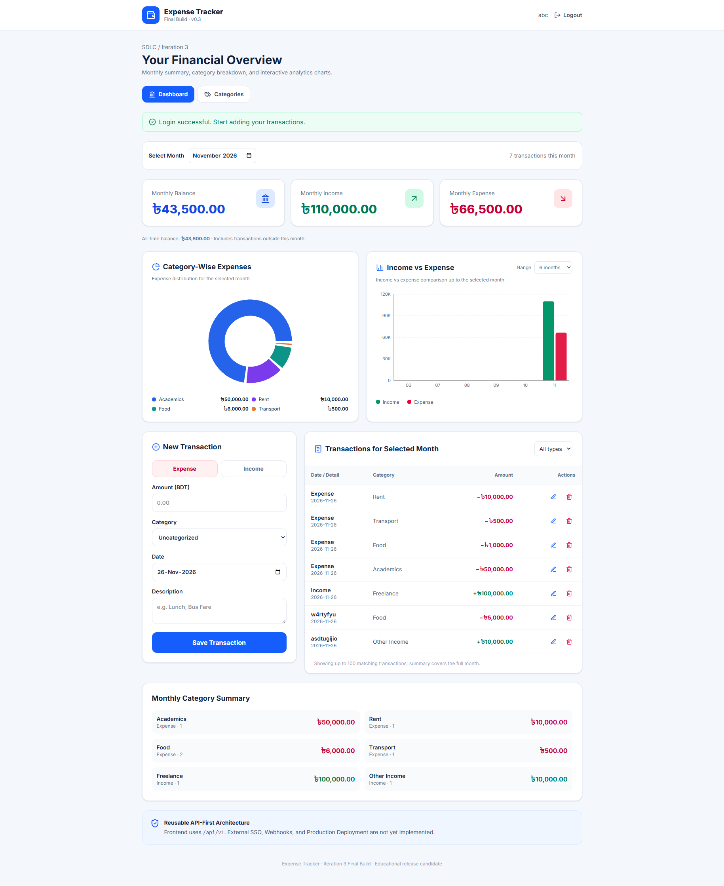
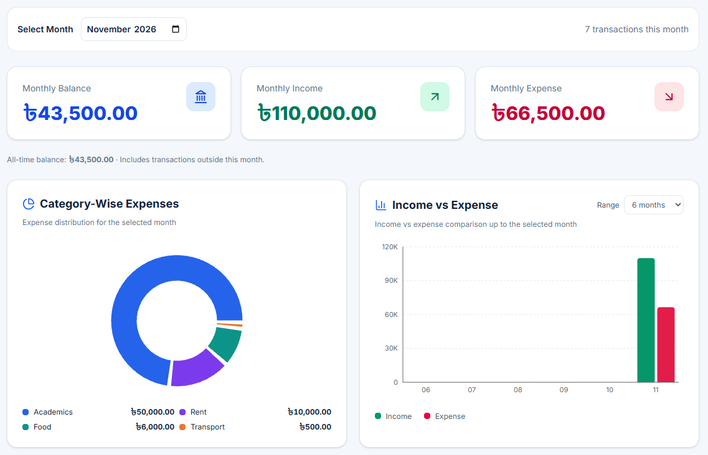
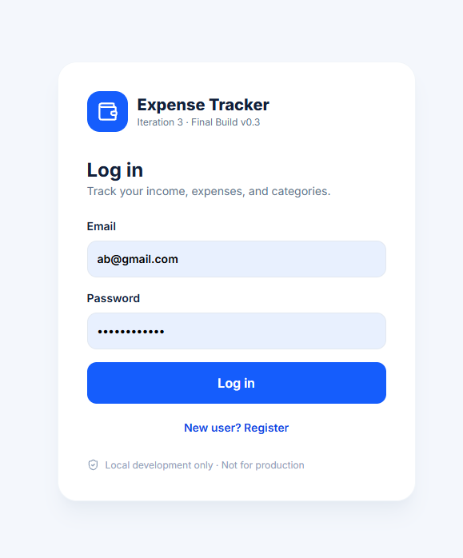
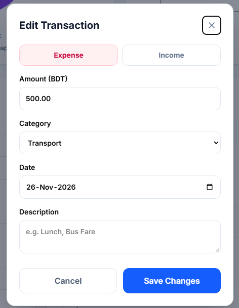
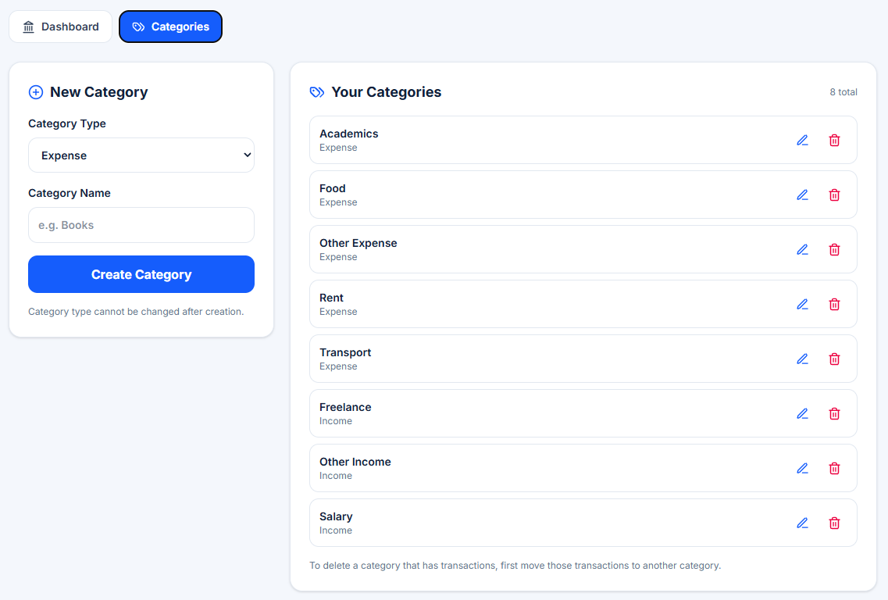
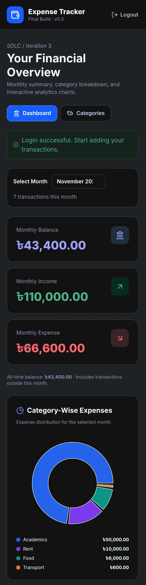
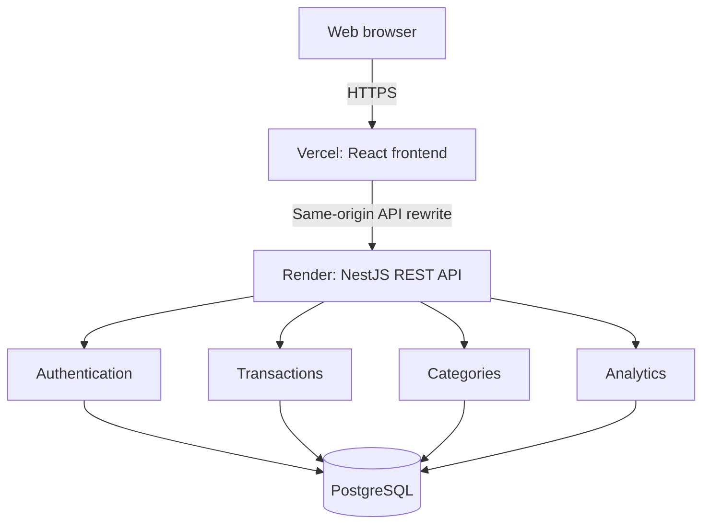

# ExpenseTracker

**Personal Expense Tracker with Analytics**

[](https://github.com/CapTainTeChieF/ExpenseTracker/actions/workflows/ci.yml)
[](CHANGELOG.md)
[](LICENSE)

Track income, manage expenses and understand your finances through an interactive dashboard.

**[Open the deployed application](https://expensetracker-eight-sable.vercel.app)** · [Documentation](#documentation) · [Local development](#local-development) · [Testing](#testing-and-quality-assurance)

## Overview

ExpenseTracker is a full-stack personal finance management web application designed for students, freelancers and individuals who want to organize their daily financial records. Users can record income and expenses, manage categories, review monthly balances and visualize spending patterns in Bangladeshi taka (BDT).

Developed as an academic Software Engineering project (CSE-3203), the application follows an iterative SDLC and an API-first modular monolith architecture. It has been deployed to Vercel and Render. The current application version is **1.0.0-rc.1**; formal release acceptance and operational verification remain ongoing.

## Features

- **Account management:** registration, login and logout with revocable cookie-based sessions.
- **Transaction management:** create, view, edit and delete personal income and expense records; modal editing preserves the dashboard scroll position.
- **Category management:** create, rename and delete unused income or expense categories.
- **Financial dashboard:** view total income, expenses, balance and monthly category summaries.
- **Interactive analytics:** category-wise expense donut chart and income-versus-expense bar chart, with 3-, 6- and 12-month trend views.
- **Filtering:** browse transactions by month and transaction type.
- **Responsive web interface:** layouts designed for desktop and mobile browsers.
- **Versioned API:** REST endpoints under `/api/v1` with OpenAPI documentation for development.


## Application screenshots

The following screenshots demonstrate the application's interface and core functionality.

### Financial dashboard



### Financial analytics



### Authentication and transaction management

| Login page | Edit transaction |
| :---: | :---: |
|  |  |

### Category management



### Mobile interface

<p align="center">
  
</p>

## Technology stack

| Layer | Technologies |
| --- | --- |
| Frontend | React, TypeScript, Vite, Tailwind CSS |
| Visualization and icons | Recharts, Lucide React |
| Backend | Node.js 24 LTS, NestJS, TypeScript |
| Database | PostgreSQL 17, SQL, `pg` driver |
| Authentication | JWT, HTTP-only cookies, bcrypt, PostgreSQL-backed sessions |
| Testing | Jest, Node.js test runner, API integration scenarios, Playwright |
| Development and CI | Git, GitHub, GitHub Actions, Docker Compose |
| Hosting | Vercel (frontend), Render (backend and PostgreSQL) |

## System architecture

The frontend communicates with the NestJS REST API. The backend groups business logic into authentication, transaction, category and analytics modules and persists records in PostgreSQL.



The production frontend uses a same-origin rewrite for `/api/v1/*` to the Render backend. This supports the application's cookie-based authentication model.

The database uses SQL migrations to manage the user, category, transaction, session and authentication rate-limit tables. See the [architecture and ERD notes](docs/ARCHITECTURE_AND_ERD.md) and [security changes](docs/STEP5_SECURITY_CHANGES_AND_REMAINING_RISKS.md) for background; the original baseline ERD predates the session and rate-limit tables.

## Repository structure

```text
ExpenseTracker/
├── .github/workflows/       # CI and manual release gate
├── backend/
│   ├── migrations/         # PostgreSQL schema migrations
│   ├── scripts/            # Migration, QA and maintenance scripts
│   └── src/                # NestJS modules and backend tests
├── frontend/
│   ├── e2e/                # Playwright browser tests
│   ├── scripts/            # Deployment configuration utilities
│   └── src/                # React interface and components
├── docs/                   # Requirements, design, QA and handover
├── scripts/                # Local setup and operational utilities
├── docker-compose.yml      # Local PostgreSQL
├── docker-compose.qa.yml   # Isolated QA PostgreSQL
├── docker-compose.full.local.yml
├── CHANGELOG.md
├── LICENSE
└── README.md
```

## Local development

### Prerequisites

- Git and Node.js 24 LTS with npm
- Docker Desktop with Docker Compose (WSL 2 backend on Windows)
- A terminal and code editor, such as PowerShell and VS Code
- PostgreSQL client utilities (`pg_dump`, `pg_restore`) only for backup and recovery tasks

### 1. Clone and start the database

For a fresh checkout:

```powershell
git clone https://github.com/CapTainTeChieF/ExpenseTracker.git
cd ExpenseTracker
docker compose up -d --wait
```

The local PostgreSQL container exposes port `5433` on the loopback interface. Use the local example configuration; never connect development or QA scripts to production data.

### 2. Configure and start the backend

From the repository root, open a terminal:

```powershell
cd backend
if (-not (Test-Path .env)) { Copy-Item .env.example .env }
```

Edit `backend/.env` before starting the application. Set a unique, cryptographically random `JWT_SECRET` of at least 32 characters, and confirm that `DATABASE_URL` points to the local database. Keep all real credentials out of version control.

| Variable | Purpose |
| --- | --- |
| `DATABASE_URL` | PostgreSQL connection string |
| `JWT_SECRET` | Secret for signing session tokens |
| `FRONTEND_ORIGIN` | Allowed frontend origin; local default `http://localhost:5173` |
| `PORT` | API listening port; local default `4000` |
| `NODE_ENV` | Runtime environment |
| `ENABLE_API_DOCS` | Optional API explorer setting; disabled by default in production |
| `TRUST_PROXY_HOPS` | Optional trusted reverse-proxy configuration |

Install dependencies, apply migrations and start the development server:

```powershell
npm ci
npm run db:migrate
npm run start:dev
```

- API health: <http://localhost:4000/api/v1/health>
- Development Swagger UI: <http://localhost:4000/docs>

For an existing database, review the migrations and back up data before upgrading. Migration `003_sessions_and_auth_limits.sql` invalidates legacy Step 4 sessions; users must log in again.

### 3. Configure and start the frontend

Open a second terminal at the repository root:

```powershell
cd frontend
if (-not (Test-Path .env)) { Copy-Item .env.example .env }
npm ci
npm run dev
```

For local development, `VITE_API_URL` should point to `http://localhost:4000/api/v1`.

Open <http://localhost:5173> in your browser. Register a local test account and start recording transactions.

For an alternative container-based setup, see `docker-compose.full.local.yml` and the [deployment runbook](docs/STEP5_DEPLOYMENT_RUNBOOK.md).

## API overview

All endpoints below use the `/api/v1` prefix. Financial resources are scoped to the authenticated user.

| Method | Endpoint | Purpose |
| --- | --- | --- |
| GET | `/health` | API and database connectivity |
| POST | `/auth/register`, `/auth/login` | Account registration and login |
| POST | `/auth/logout` | Revoke session and log out |
| GET | `/auth/me` | Current user profile |
| GET, POST | `/transactions` | List or create transactions |
| PATCH, DELETE | `/transactions/:id` | Edit or delete a transaction |
| GET, POST | `/categories` | List or create categories |
| PATCH, DELETE | `/categories/:id` | Rename or delete a category |
| GET | `/analytics/summary` | Financial totals |
| GET | `/analytics/monthly` | Monthly summary |
| GET | `/analytics/trend` | Income and expense trends |

See the [API integration guide](docs/STEP6_API_INTEGRATION_GUIDE.md) for query parameters, authentication and integration constraints. The API is not currently a public third-party integration service.

## Security and data integrity

Implemented controls include bcrypt password hashing, HTTP-only session cookies (Secure in production), server-side session revocation, database-backed login and registration rate limiting, request validation, Helmet middleware, production mutation Origin checks, parameterized SQL and user-scoped resource access. Financial values are stored as PostgreSQL `NUMERIC` values, and database transactions protect relevant multi-step writes.

These controls reduce known risks but do not establish complete security or independent security certification. See the [security review](docs/SECURITY_REVIEW.md) and [remaining risks](docs/STEP5_SECURITY_CHANGES_AND_REMAINING_RISKS.md).

Never commit real `.env` files, database dumps, passwords, access tokens or unsanitized financial and QA records.

## Testing and quality assurance

GitHub Actions runs backend tests, helper tests, TypeScript checks, builds and API integration scenarios against an isolated PostgreSQL database. The frontend job runs TypeScript checks and a production build. Playwright browser tests are available separately and are not part of the current CI workflow.

### Backend tests and isolated API integration

From the repository root (with dependencies installed):

```powershell
docker compose -f docker-compose.qa.yml -p expense-tracker-qa up -d --wait
cd backend
npm run qa:all
```

The QA database uses local port `5434` and is separate from development and production. Generated API reports are saved under `docs/qa-evidence/`; inspect and sanitize reports before sharing.

### Frontend checks and browser tests

From the repository root:

```powershell
cd frontend
npm run typecheck
npm run build
```

After a successful backend QA build and integration run, keep the QA database running. In a separate terminal at the repository root:

```powershell
cd backend
npm run qa:server
```

In another terminal at the repository root:

```powershell
cd frontend
npx playwright install chromium
npm run qa:browser
```

Ensure the local frontend development server is stopped before browser testing; Playwright starts its own QA frontend on port `5173`. The QA API runs on port `4100`. Stop the QA server with Ctrl+C after testing.

### Verification status

The [CI run for the 26 November 2026 baseline](https://github.com/CapTainTeChieF/ExpenseTracker/actions/runs/45765279626) completed successfully for both jobs and produced a backend QA evidence artifact. Consult [GitHub Actions](https://github.com/CapTainTeChieF/ExpenseTracker/actions) for subsequent runs.

Current browser regression evidence, the dashboard latency benchmark, formal UAT and an observed database restore drill still require confirmation before stable-release acceptance. Passing CI alone does not demonstrate production availability or operational readiness.

## Deployment

| Component | Platform |
| --- | --- |
| Web application | [Vercel](https://expensetracker-eight-sable.vercel.app) |
| REST API | Render |
| PostgreSQL database | Render |
| Continuous integration | GitHub Actions |

The application has a configured Vercel API rewrite in `frontend/vercel.json`. Production builds require `VITE_API_URL=/api/v1` and a correctly configured backend origin and environment. Do not expose backend or database credentials in frontend configuration.

A read-only connectivity check is available at [the deployed health endpoint](https://expensetracker-eight-sable.vercel.app/api/v1/health). Current availability must be verified separately.

See the [deployment runbook](docs/STEP5_DEPLOYMENT_RUNBOOK.md), [release gates](docs/STEP5_RELEASE_GATES.md) and [backup and recovery procedure](docs/STEP5_BACKUP_RECOVERY.md). The manual release-gate workflow records approval assertions; it does not deploy the application.

## Documentation

The repository contains historical iteration documents as well as release and handover drafts. Some documents are being reconciled with the deployed application's current status; a draft or prepared procedure is not proof of acceptance or execution.

| Document | Purpose |
| --- | --- |
| [SRS (for approval)](docs/STEP6_SRS_v1.0_FOR_APPROVAL.md) | Functional and non-functional requirements |
| [SDLC project report](docs/STEP6_SDLC_PROJECT_REPORT.md) | Development methodology and milestones |
| [Architecture and ERD](docs/ARCHITECTURE_AND_ERD.md) | Baseline design and database relationships |
| [API integration guide](docs/STEP6_API_INTEGRATION_GUIDE.md) | REST API and integration limitations |
| [QA test matrix](docs/QA_TEST_MATRIX.md) | Test coverage and scenarios |
| [Requirement traceability matrix](docs/STEP6_REQUIREMENT_TRACEABILITY_MATRIX.csv) | Requirements mapped to verification |
| [Performance test protocol](docs/PERFORMANCE_TEST_PROTOCOL.md) | Dashboard latency measurements |
| [Release gates](docs/STEP5_RELEASE_GATES.md) | Release acceptance criteria |
| [Deployment runbook](docs/STEP5_DEPLOYMENT_RUNBOOK.md) | Hosting and configuration procedures |
| [Backup and recovery](docs/STEP5_BACKUP_RECOVERY.md) | PostgreSQL recovery procedures |
| [Handover checklist](docs/STEP6_HANDOVER_CHECKLIST.md) | Operational handover |
| [Presentation outline](docs/STEP6_PRESENTATION_OUTLINE.md) | Academic demonstration plan |
| [Changelog](CHANGELOG.md) | Version and change history |

## Known limitations and roadmap

- BDT-only personal ledger; no multi-currency or shared workspaces.
- Transaction listings are limited to 100 matching records; pagination is not implemented.
- External OAuth/OIDC, SSO, webhooks, offline synchronization and receipt OCR are outside the current scope.
- Long-term database hosting, automated backups, restore verification, monitoring and further security hardening remain maintenance priorities.
- Dependency lockfiles exist; moving CI installation from `npm install` to `npm ci` is a reproducibility improvement still to be addressed.
- Documentation, formal acceptance and a stable release remain in preparation.

## Academic project

| Item | Details |
| --- | --- |
| Project | Personal Expense Tracker with Analytics |
| Course | Software Engineering (CSE-3203) |
| Discipline | Computer Science and Engineering |
| Methodology | Iterative SDLC |
| Current version | `1.0.0-rc.1` |
| Repository | [CapTainTeChieF/ExpenseTracker](https://github.com/CapTainTeChieF/ExpenseTracker) |

## License

ExpenseTracker is open-source software licensed under the [MIT License](LICENSE).
