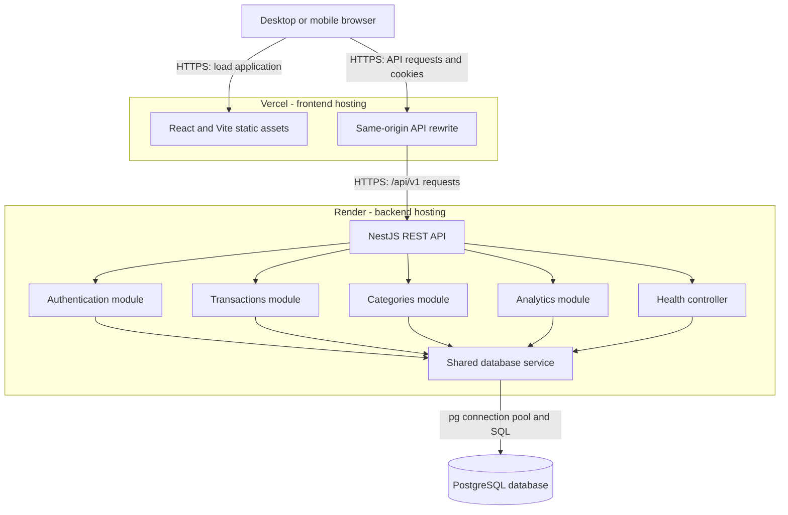
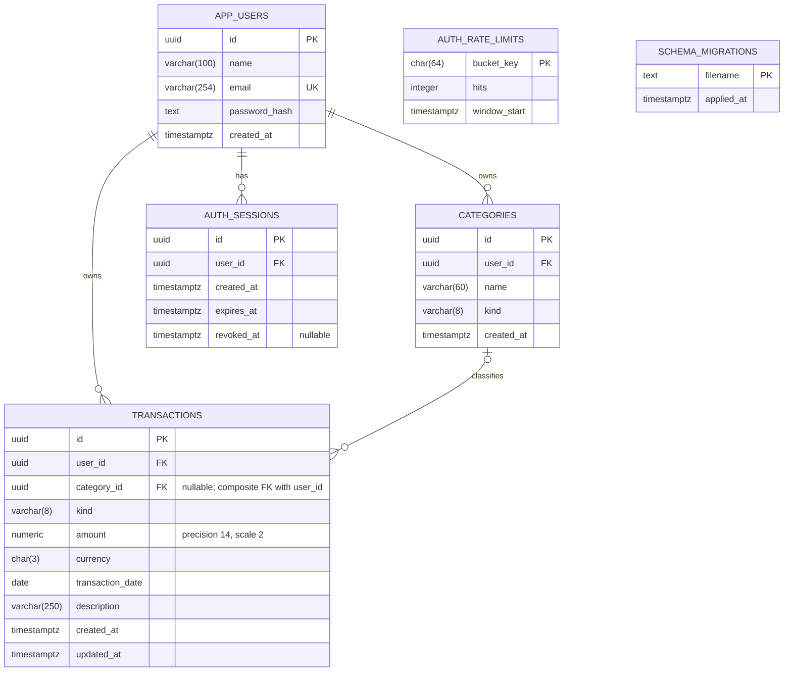
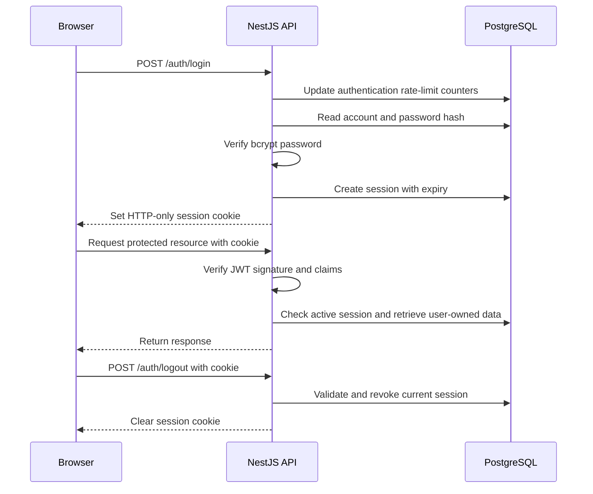

# System Architecture and Entity Relationship Diagram

**Project:** ExpenseTracker — Personal Expense Tracker with Analytics (CSE-3203)
**Application version:** `1.0.0-rc.1`
**Source baseline:** [`e017f1e`](https://github.com/CapTainTeChieF/ExpenseTracker/commit/e017f1e1c6eadb8b4ac3c5e62af8a89df0d6ed64)
**Scope:** Current implemented source design and documented deployment configuration.

This document describes the application as implemented in the source baseline. It supersedes the original three-table ERD and initial API contract. It does not certify the live database schema, cloud availability, security acceptance or stable-release readiness.

## 1. System architecture

ExpenseTracker uses a three-tier, API-first modular monolith. The browser runs a React/TypeScript application built with Vite; a single NestJS REST API organizes business logic into modules; PostgreSQL stores persistent records. The backend uses the `pg` driver rather than an ORM.

### Deployment topology

The repository documents Vercel frontend hosting and Render backend and database hosting. The diagram represents the configured architecture, not a newly performed live deployment check.

- Local development uses the frontend at `http://localhost:5173` and the API at `http://localhost:4000/api/v1`.
- Production frontend builds use `VITE_API_URL=/api/v1`. The rewrite in [`frontend/vercel.json`](../frontend/vercel.json) forwards API requests to Render before the SPA fallback rule.
- Browser requests include credentials. The same-origin rewrite supports cookie-based authentication without requiring the browser to call a different origin directly.
- The API uses a shared PostgreSQL connection pool with a configured maximum of 10 connections per backend process.
- GitHub Actions performs automated build and test verification separately from the application request path. The manual release-gate workflow is not a deployment mechanism.

### Module responsibilities

| Component | Responsibility |
| --- | --- |
| Frontend | Authentication forms, transaction and category management, financial summaries, responsive layouts and Recharts visualizations |
| Authentication | Registration, password verification, JWT issuance, session validation/revocation and rate limiting |
| Transactions | User-scoped listing, creation, update and deletion; category validation |
| Categories | User-scoped category creation, listing, renaming and deletion of unused categories |
| Analytics | Lifetime totals, monthly summaries, category breakdowns and rolling monthly trends |
| Database | Shared PostgreSQL connection pool and SQL access |
| Health | Public API/database connectivity check using `SELECT 1` |

## 2. Entity relationship diagram (ERD)

The three SQL migrations define five application tables. The migration runner creates an additional operational bookkeeping table, `schema_migrations`. The ERD includes all six source-defined tables; the last two independent entities have no declared foreign-key relationships.

**Notation:** PK = primary key; FK = foreign key; UK = unique key. The category relationship is optional on the transaction side: a transaction may have no category, or one category. A category can classify zero or many transactions. Composite constraints are detailed below because the ERD alone does not fully express them.

### 2.1. Table responsibilities and relationships

| Table | Purpose | Relationships |
| --- | --- | --- |
| `app_users` | Account identity and password hash | Parent of categories, transactions and sessions |
| `categories` | User-defined income and expense categories | Each category belongs to one user; may classify many transactions |
| `transactions` | Personal financial records | Each belongs to one user; optionally references a category owned by that same user |
| `auth_sessions` | Persistent session expiry and revocation records | Each session belongs to one user |
| `auth_rate_limits` | Hashed authentication throttling counters | Independent table; no user foreign key |
| `schema_migrations` | Applied SQL migration filenames and timestamps | Independent operational table; not a business entity |

### 2.2. Constraints and defaults

| Table | Implemented rules |
| --- | --- |
| `app_users` | UUID primary key generated with `gen_random_uuid()`; email unique and required; name, password hash and creation timestamp required; timestamp defaults to `NOW()` |
| `categories` | Generated UUID primary key; required `user_id` references `app_users(id)` with `ON DELETE CASCADE`; required name and kind; kind restricted to `INCOME` or `EXPENSE`; unique `(id, user_id)` and `(user_id, kind, name)`; case-insensitive unique index on `(user_id, kind, LOWER(name))`; creation timestamp defaults to `NOW()` |
| `transactions` | Generated UUID primary key; required `user_id` references `app_users(id)` with `ON DELETE CASCADE`; nullable `category_id`; composite foreign key `(category_id, user_id)` references `categories(id, user_id)` with `ON DELETE RESTRICT`; required kind restricted to `INCOME` or `EXPENSE`; required `NUMERIC(14,2)` amount greater than zero; required `CHAR(3)` currency fixed to `BDT` with that default; required date, description (default empty string), creation and update timestamps (default `NOW()`) |
| `auth_sessions` | UUID primary key supplied by the application; required user FK with `ON DELETE CASCADE`; required creation and expiry timestamps; nullable revocation timestamp; creation timestamp defaults to `NOW()` |
| `auth_rate_limits` | `CHAR(64)` primary key; required integer hit count defaulting to zero; required window start defaulting to `NOW()` |
| `schema_migrations` | Migration filename is the text primary key; required applied timestamp defaults to `NOW()` |

The composite category foreign key prevents a transaction from referencing another user's category. Matching the category's income/expense kind is an additional **application-level** check performed by `TransactionsService`, not a database foreign-key constraint. Referenced categories cannot be deleted through the category API until their transactions are reassigned or uncategorized.

### 2.3. Explicit indexes

The following indexes are declared separately from primary-key and unique-constraint indexes:

| Index | Definition or purpose |
| --- | --- |
| `idx_transactions_user_date` | `transactions(user_id, transaction_date DESC)` |
| `idx_transactions_user_kind` | `transactions(user_id, kind)` |
| `uq_categories_user_kind_lower_name` | Unique `categories(user_id, kind, LOWER(name))` |
| `idx_auth_sessions_user_id` | `auth_sessions(user_id)` |
| `idx_auth_sessions_active` | Partial index on `auth_sessions(id, user_id)` where `revoked_at IS NULL` |
| `idx_auth_rate_limits_window` | `auth_rate_limits(window_start)` |

### 2.4. Migration history

| Migration | Purpose |
| --- | --- |
| [`001_init.sql`](../backend/migrations/001_init.sql) | Users, categories, transactions and baseline constraints/indexes |
| [`002_case_insensitive_categories.sql`](../backend/migrations/002_case_insensitive_categories.sql) | Case-insensitive category uniqueness within each user and kind |
| [`003_sessions_and_auth_limits.sql`](../backend/migrations/003_sessions_and_auth_limits.sql) | Persistent sessions and authentication rate-limit counters |

The [migration runner](../backend/scripts/migrate.cjs) creates `schema_migrations`, executes unapplied SQL files in filename order and records each successful migration inside its transaction. It rolls back a failed migration. It tracks filenames and timestamps, not checksums. Migration 002 can fail if conflicting category names already exist; migration 003 invalidates legacy sessions without the new session identifier. Review and back up existing data before any schema upgrade.

## 3. REST API contract overview

All endpoints use the `/api/v1` prefix. Protected routes derive user identity from the validated session; they do not accept a client-supplied owner ID for authorization.

| HTTP | Path (after `/api/v1`) | Access | Purpose |
| --- | --- | --- | --- |
| GET | `/health` | Public | API/database connectivity |
| POST | `/auth/register` | Public, rate-limited | Create account and session |
| POST | `/auth/login` | Public, rate-limited | Authenticate and create session |
| POST | `/auth/logout` | Authenticated | Revoke current session and clear cookie |
| GET | `/auth/me` | Authenticated | Return current user profile |
| GET | `/categories` | Authenticated | List own categories |
| POST | `/categories` | Authenticated | Create a category |
| PATCH | `/categories/:id` | Owner | Rename category |
| DELETE | `/categories/:id` | Owner | Delete unused category |
| GET | `/transactions` | Authenticated | List up to 100 own records; optional `month`, `kind`, `categoryId` filters |
| POST | `/transactions` | Authenticated | Create transaction |
| PATCH | `/transactions/:id` | Owner | Update transaction |
| DELETE | `/transactions/:id` | Owner | Delete transaction |
| GET | `/analytics/summary` | Authenticated | Lifetime totals and count |
| GET | `/analytics/monthly?month=YYYY-MM` | Authenticated | Monthly totals and category breakdown |
| GET | `/analytics/trend` | Authenticated | Rolling 1–12 months; optional `months` (default 6) and `endMonth` (default current UTC month) |

The current frontend offers 3-, 6- and 12-month trend selections; the API supports any integer from 1 through 12. Development Swagger UI is available at `/docs`, and the OpenAPI JSON at `/docs/openapi.json`. Production API docs are disabled by default. See the [API integration guide](STEP6_API_INTEGRATION_GUIDE.md) for compatibility boundaries and future integration constraints.

## 4. Security and data integrity

### 4.1. Authentication lifecycle

This diagram shows the successful login, protected-request and logout path; invalid credentials, throttled attempts, revoked sessions and database failures have separate error paths in the implementation.

### 4.2. Implemented controls

- Passwords are hashed using bcrypt with cost factor 12. Login compares the supplied password with the stored hash.
- Signed JWTs contain a user identifier and session identifier, with a 12-hour lifetime. The `expense_session` cookie is HTTP-only, `SameSite=Lax`, scoped to `/api/v1` and Secure in production.
- `AuthGuard` verifies the JWT and checks for a matching, unexpired and unrevoked session in PostgreSQL. Logout revokes that session before clearing its cookie.
- Database-backed authentication throttling uses SHA-256 bucket keys rather than plaintext email or IP values. The login limits are 20 attempts per IP and 10 per normalized email per 15-minute window; registration is limited to 6 per IP per hour. Exceeded limits return HTTP 429.
- Helmet, explicit CORS origin configuration and DTO validation are enabled. Production mutation requests must carry the configured trusted Origin header; this is a CSRF mitigation, not proof of comprehensive CSRF protection.
- Parameterized SQL and user-scoped resource queries enforce application-level ownership. PostgreSQL row-level security is not claimed.
- PostgreSQL `NUMERIC(14,2)` stores exact decimal monetary values. SQL aggregates calculate income, expense and balance; the API returns monetary amounts as decimal strings. Analytics are computed from records, not persisted in a separate summary table.
- Registration creates the account, default categories and initial session in one transaction. Transaction creation and updates use explicit transaction boundaries; updates lock the existing row with `FOR UPDATE`.

## 5. Boundaries and maintenance priorities

The architecture does not include external OAuth/OIDC or SSO, webhooks, a public partner authentication API, multi-currency, multiple workspaces or transaction pagination beyond the current 100-record list limit. These are future possibilities, not implemented components.

Permanent database hosting arrangements, backup scheduling and recovery drills, operational monitoring, production security review, browser regression evidence, performance benchmarking and formal acceptance must be confirmed separately. A documented control is not evidence that a deployment or acceptance test passed.

## 6. Source references

- [Frontend application](../frontend/src/App.tsx) and [Vercel configuration](../frontend/vercel.json)
- [Backend bootstrap](../backend/src/main.ts), [root module](../backend/src/app.module.ts) and [database service](../backend/src/database/database.service.ts)
- [Authentication controller](../backend/src/auth/auth.controller.ts), [service](../backend/src/auth/auth.service.ts), [guard](../backend/src/auth/auth.guard.ts) and [rate limiter](../backend/src/auth/auth-rate-limit.service.ts)
- [Categories controller](../backend/src/categories/categories.controller.ts) and [service](../backend/src/categories/categories.service.ts)
- [Transactions controller](../backend/src/transactions/transactions.controller.ts) and [service](../backend/src/transactions/transactions.service.ts)
- [Analytics controller](../backend/src/analytics/analytics.controller.ts) and [service](../backend/src/analytics/analytics.service.ts)
- [Migration files](../backend/migrations/) and [migration runner](../backend/scripts/migrate.cjs)
- [Deployment runbook](STEP5_DEPLOYMENT_RUNBOOK.md), [backup and recovery procedure](STEP5_BACKUP_RECOVERY.md), [release gates](STEP5_RELEASE_GATES.md) and [README](../README.md)

Update this document when the API, schema, security model or deployment architecture changes. Preserve the source baseline and record operational verification separately.
