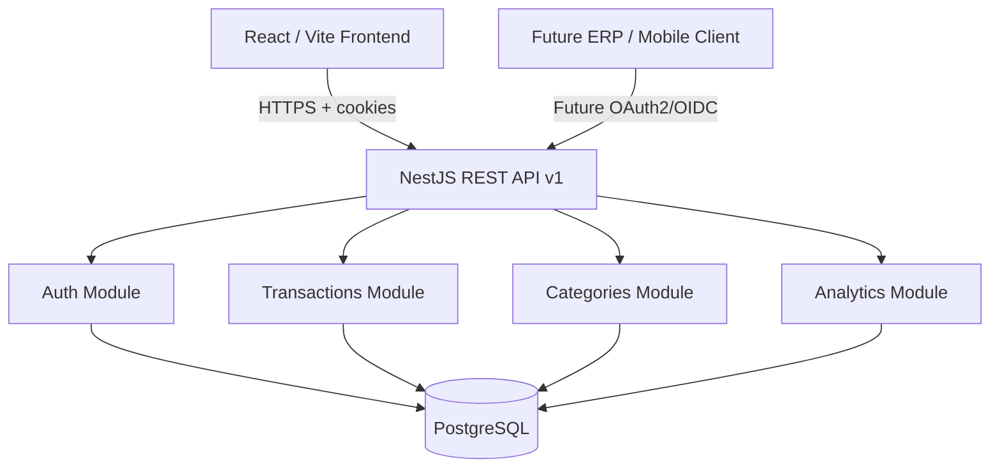
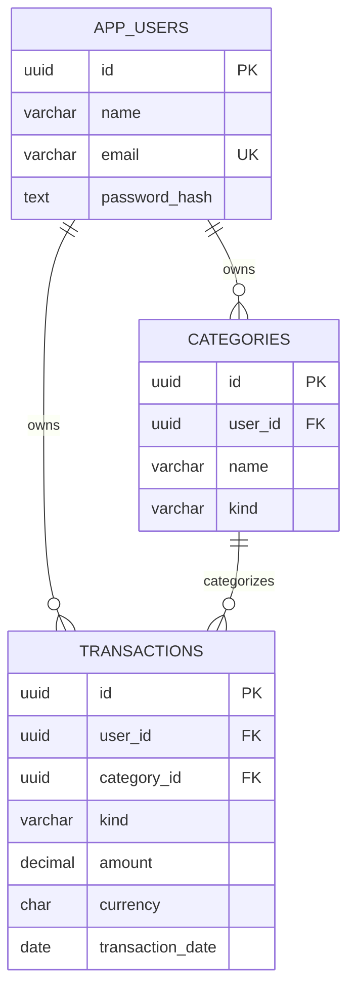

# Architecture, ERD and Initial API Contract

## API-first Modular Monolith

## Baseline ERD

## Baseline endpoints
| HTTP | Path | Access | Purpose |
|---|---|---|---|
| GET | /api/v1/health | Public | DB connectivity |
| POST | /api/v1/auth/register | Public | Register |
| POST | /api/v1/auth/login | Public | Login |
| POST | /api/v1/auth/logout | Public | Clear session |
| GET | /api/v1/auth/me | Logged in | Profile |
| GET | /api/v1/categories | Logged in | Default category list |
| GET | /api/v1/transactions | Logged in | Last 100 transactions |
| POST | /api/v1/transactions | Logged in | Create |
| PATCH | /api/v1/transactions/:id | Owner | Update |
| DELETE | /api/v1/transactions/:id | Owner | Delete |
| GET | /api/v1/analytics/summary | Logged in | Lifetime summary |

## Security & Architecture decisions
- Identity comes from signed HTTP-only session cookie; `user_id` is never passed from browser into SQL ownership clauses.
- Protected SQL queries always include `WHERE user_id = $...` or equivalent.
- PostgreSQL NUMERIC avoids floating point error for stored amounts.
- Registration creates user and default categories within one DB transaction.
- Updating a transaction is an atomic, row-locked DB transaction.
- The cookie strategy requires same-site frontend/backend deployment or appropriate secure cross-site setup.
- This starter is **not** complete production security hardening: rate limiting, CSRF token review, password recovery, MFA, audit trail, backups, RLS, API consumer auth, policy review and load testing remain.
- `pg` is used directly here to reduce initial tooling complexity and show SQL clearly. A Prisma-based repository implementation can be added without changing the API contract.
