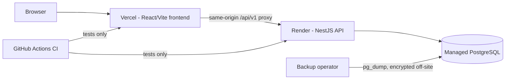

# Step 5 — Deployment, CI/CD, Monitoring and Security Runbook

**Document status:** implementation template; deployment not executed. **Version:** v1.0-rc.1, 2026-11-09.

## Target topology

The Vercel rewrite keeps session cookie requests same-origin at `/api/v1` and avoids mixing an unrelated `vercel.app` site with `onrender.com` cookies. Ensure the external API host uses HTTPS and verify that the proxy forwards `Set-Cookie`, `Origin` and `Cookie` correctly. A custom same-site `app.example.com` and `api.example.com` setup is also possible, but needs deliberate CORS/cookie testing.

## Ordered operator checklist

### A. Prerelease

1. Restore code from delivered ZIP into Git; review every file and remove placeholder hostnames.
2. On a machine with internet, run `npm install` in `backend/` and `frontend/`. Commit generated `package-lock.json` files. For immutable CI use `npm ci` (update YAML/Dockerfile after locks are committed).
3. Run all backend and frontend tests in a clean QA environment (step4 QA documents).
4. Verify 30 dashboard update measurements (target <= 2 s), authorization isolation, browser cookies, login throttle, logout replay rejection and new user registration. Record evidence.
5. Confirm backups, recovery point objective (RPO), recovery time objective (RTO), retention and encryption with project owner.
6. Security owner approves outstanding risks, secrets handling and origin/proxy behavior.

### B. Staging database

1. Create PostgreSQL 17 staging database. Avoid public network access wherever possible.
2. Create a least-privilege application account with necessary SQL permissions; perform schema migrations using a separate migration account when operationally practical.
3. Keep `DATABASE_URL` out of Git, screenshots and CI artifacts.
4. Before migrating a real database, create/verify a backup. Run `npm run db:migrate` once from trusted environment; migration `003` is additive.
5. Verify `schema_migrations` contains `001`, `002`, `003`. Re-login to create a new revocable session.

### C. Render API (example host)

1. Create a Web Service from GitHub; set root directory `backend` (for native Node runtime). Use Node 24.
2. Build `npm install --no-audit && npm run build`; Start `npm run start:prod` (if using Docker, point to `backend/Dockerfile` as shown in `backend/render.example.yaml`).
3. Set secret env vars: `DATABASE_URL`, `JWT_SECRET` (unique 64+ character random), `FRONTEND_ORIGIN` (exact final frontend origin). Set `NODE_ENV=production`, `PORT=10000`, `ENABLE_API_DOCS=false`. Configure `TRUST_PROXY_HOPS` only after provider proxy topology verification.
4. Set health check `/api/v1/health` and confirm response 200.
5. On paid Render service, a pre-deploy migration command may be used; otherwise run migration explicitly from a trusted operator shell before exposing traffic. Never rely on migrations silently running in parallel on every container start.

### D. Vercel frontend

1. At `frontend/`, run `npm run configure:vercel -- https://YOUR-REAL-API.onrender.com`.
2. Run `npm run verify:production` (must pass); commit generated `vercel.json`.
3. Set Vercel project root = `frontend`, framework = Vite, build = `npm run build`, output = `dist`.
4. Set `VITE_API_URL=/api/v1` for production (nonsecret public setting). Deploy staging and verify the API proxy, cookie, login, registration and dashboard data.
5. Configure backend `FRONTEND_ORIGIN` to match the exact https://frontend-host origin; redeploy backend if needed.
6. Confirm the proxy does not expose Swagger at `/docs` and that no sensitive server errors leak information.

### E. Verification and production promotion

- `node scripts/ops/smoke-test.mjs https://API_HOST https://FRONTEND_HOST` (checks health, unauthorized access, frontend and proxy only; never writes data).
- Manual browser smoke: Register, login, create/update/delete transactions, category and chart rendering, logout and replay protection.
- Save CI logs, test matrix, screenshots and performance distributions in restricted evidence storage. Do **not** upload real user financial data.
- Security approval, QA/UAT sign-offs and successful staging restore test are required before production promotion.
- After go-live, monitor request errors, p95 latency, auth throttles, PostgreSQL connections, disk usage, CPU and unusual sign-in patterns. Alerting requires external monitoring setup; this package only documents it.

## Rollback

- Application regression: roll backend/frontend to previous verified artifact/commit; do not automatically roll database schema backwards. New DB tables are additive but old session tokens and app versions may differ.
- Data incident: invoke tested recovery procedure under incident commander approval; restoring changes financial records and may lose post-backup transactions. Capture exact recovery time and get owner authorization.
- Never run destructive `pg_restore --clean` against production from unattended scripts.

## Risks / out-of-scope

- No cloud account is connected: neither actual Vercel/Render deployment nor DNS binding has been performed.
- Free-tier sleep, cold starts and region selection can violate the 2-second SLA; choose hosting and evaluate with live metrics.
- Full SSO/OIDC, third-party API clients, external webhooks and multi-tenancy require later work.
- IP throttle correctness behind proxies must be tested; incorrect trust-proxy config can throttle all users or trust attacker-supplied forwarding headers.
