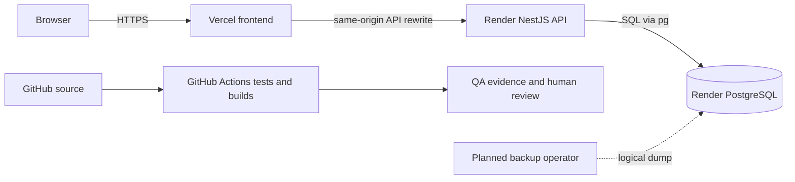

# Step 5 — Deployment, CI/CD, Monitoring and Security Runbook

**Original preparation:** 2026-11-09. **Documentation baseline:** 2026-11-26 UTC, commit `98e0c51`.
**Application package version:** `1.0.0-rc.1` (frontend and backend).
**Status:** Release candidate previously deployed; stable-release approval outstanding. Live infrastructure settings and current service health have not been independently checked for this revision.

## 1. Deployment inventory and topology

| Component | Recorded location / configuration | Evidence and limits |
|---|---|---|
| Web application | [Vercel](https://expensetracker-eight-sable.vercel.app) | Deployment history and README; live deployment commit unverified |
| API | [Render](https://expense-tracker-api-bbp8.onrender.com/api/v1/health) | Backend origin in committed Vercel rewrite; live settings unverified |
| Database | Render-hosted PostgreSQL | Project deployment history and README; plan, expiry, version, region and connectivity not independently confirmed |
| Source | [GitHub repository](https://github.com/CapTainTeChieF/ExpenseTracker) | `main` at `98e0c51` at this baseline |
| CI | [GitHub Actions](https://github.com/CapTainTeChieF/ExpenseTracker/actions) | Tests and builds; no production deploy step in CI |
| Release gate | Manual workflow | Approval assertions only; known logic defect; see [release gates](STEP5_RELEASE_GATES.md) |



See [architecture and ERD](ARCHITECTURE_AND_ERD.md) for detailed module and database design. The frontend calls `/api/v1` on its own origin; [vercel.json](../frontend/vercel.json) forwards API requests to the HTTPS Render origin and sends other routes to `index.html`. This avoids relying on cross-site cookies between unrelated `vercel.app` and `onrender.com` sites. Verify actual forwarding of Cookie, Set-Cookie and Origin at runtime. The diagram is not evidence of automated CD, scheduled backups or live monitoring.

## 2. Configuration reference

The following are intended settings from repository code, examples and deployment documentation. Confirm actual values privately in the hosting dashboards before changing anything. Never copy credentials, connection strings or JWT secrets into this document, a ticket, screenshots, chat or CI artifacts.

| Location | Setting | Intended value / handling |
|---|---|---|
| Vercel | Project root | `frontend` |
| Vercel | Framework / build / output | Vite / `npm run build` / `dist` |
| Vercel | `VITE_API_URL` | `/api/v1` (public build-time setting, not a secret) |
| Render API | Runtime | Node 24 for native Node; Docker example also supplied; actual runtime unverified |
| Render API | Native root / build / start | `backend` / `npm install --no-audit && npm run build` / `npm run start:prod` |
| Render API | Health check | `/api/v1/health` |
| Render API | `NODE_ENV` | `production` |
| Render API | `PORT` | Provider-assigned port; example 10000; app listens on `0.0.0.0` |
| Render API | `DATABASE_URL` | Secret, correct database identity and approved connection/TLS configuration |
| Render API | `JWT_SECRET` | Secret, strong unique random value (code requires at least 32 characters; original runbook recommends 64+) |
| Render API | `FRONTEND_ORIGIN` | Exact frontend origin `https://expensetracker-eight-sable.vercel.app` for the recorded deployment, no trailing slash |
| Render API | `ENABLE_API_DOCS` | `false` or unset in production; explicit true exposes Swagger |
| Render API | `TRUST_PROXY_HOPS` | Leave unset/0 unless actual proxy topology is verified; code accepts integer 1 or 2 |

[Dockerfile](../backend/Dockerfile) and [Render Blueprint example](../backend/render.example.yaml) are illustrative, not verified live configuration. Do not rename the example into an auto-provisioning blueprint without review. PostgreSQL 17 is configured in local/QA environments; do not infer the production version from that fact. Secrets belong in provider-managed configuration, never Vite variables. Rotation of JWT secrets invalidates existing signed sessions; coordinate and verify login after rotation.

## 3. Routine change and deployment procedure

For an ordinary documentation-only change, follow the branch/PR workflow and review CI. No deliberate redeployment, migration or hosting change is required. A hosting provider may still build automatically on merge depending on its unverified settings.

1. Start from clean, synchronized `main`; use a dedicated branch, scoped commits and reviewed PR. Record the change ticket, source commit and current deployed commit/artifact separately.
2. Review [release gates](STEP5_RELEASE_GATES.md), [QA matrix](QA_TEST_MATRIX.md) and [RTM](STEP6_REQUIREMENT_TRACEABILITY_MATRIX.csv). Preserve evidence and obtain required approvals before stable promotion.
3. Both package lockfiles are committed. Use `npm ci` for a reviewed reproducible local install where applicable. Existing CI and Dockerfile still use `npm install --no-audit`; migrating them to `npm ci` is separate maintenance, not done here.
4. For routing changes only, verify the real HTTPS API origin and regenerate `vercel.json` from `frontend/` using `npm run configure:vercel -- https://expense-tracker-api-bbp8.onrender.com` (substitute an approved new origin if relocating). This writes the file; review the diff and commit deliberately. Do not regenerate an already correct file as routine work.
5. Validate current routing from the repository root using the read-only source configuration check below. It checks an HTTPS rewrite and placeholder condition only; it does not contact either host or verify dashboard environment variables.

```powershell
Push-Location frontend
npm run verify:production
Pop-Location
```

6. For a code release, run CI and required browser, security, performance and recovery checks against isolated QA/staging. Resolve gates or document authorized exceptions; never use the defective manual gate as sole approval evidence.
7. Review provider dashboard build settings, target branch, auto-deploy behavior, deployed SHA, environment and rollback artifact. If approved, deploy compatible backend/frontend builds through the provider's actual configured workflow. Do not assume a successful PR or GitHub Actions run deploys the app. A separate staging deployment has not been established by current evidence.
8. Verify the live paths and record results as described below. If a regression appears, stop promotion, preserve evidence and follow rollback/incident procedure.

## 4. New environment / disaster rebuild only

This section preserves initial provisioning guidance. Do not repeat it against the working services merely to modernize documentation.

- Provision a separately named and isolated staging PostgreSQL database; verify version, region, access restrictions, least-privilege credentials and TLS. Prefer separate migration permissions where practical.
- Confirm backups and recovery arrangements before touching existing data. Review migrations and execute only with explicit authorization against the identified target from a trusted operator environment.
- Create/configure the Render service using the native Node or reviewed Docker path above. Set secret environment variables privately and verify the health check. Create/configure the Vercel frontend and approved rewrite; coordinate origin configuration.
- Validate staging and obtain release approvals before promoting a stable build. Do not point staging at the production database, reuse production secrets or expose restored private records to ordinary QA users.

### Schema migration safety

The [migration runner](../backend/scripts/migrate.cjs) reads SQL filenames in order, skips recorded filenames and commits each unapplied file with its `schema_migrations` record. It does not track checksums or coordinate parallel migration processes. Run one approved migration process at a time; do not edit an already applied migration or run it automatically on every replica startup.

Before migration: confirm exact database identity, take and verify an appropriate backup, review compatibility and test on staging. Only then use `npm run db:migrate` from `backend/` with the authorized target configured privately. This is a database-writing operation, not a documentation verification step. Check the filename records (`001_init.sql`, `002_case_insensitive_categories.sql`, `003_sessions_and_auth_limits.sql`) and expected schema afterward. Migration 002 may fail on case-conflicting categories; migration 003 adds session/rate-limit tables and legacy tokens require re-login. No production migration is requested here.

## 5. Live verification and troubleshooting

### Read-only smoke checks (operator procedure, not an executed result)

From repository root with Node installed:

```powershell
node scripts/ops/smoke-test.mjs https://expense-tracker-api-bbp8.onrender.com https://expensetracker-eight-sable.vercel.app
```

The [smoke script](../scripts/ops/smoke-test.mjs) issues four GET requests with a 10-second timeout per request and stops on failure. It follows redirects and checks status codes, not response-body semantics or deployed version.

| Check | Expected HTTP status |
|---|---|
| Direct API `/api/v1/health` | 200 |
| Direct API `/api/v1/transactions` without cookie | 401 |
| Frontend `/` | 200 |
| Frontend `/api/v1/health` via rewrite | 200 |

For health responses, also inspect that JSON reports `status: ok`, `service: expense-tracker-api`, `database: connected`. The [health controller](../backend/src/common/health.controller.ts) runs `SELECT 1`, logs a database error code and returns generic 503 if connectivity fails. A 200 is not proof of data integrity, migration completeness or availability over time.

| Symptom | First safe diagnostic |
|---|---|
| Direct health 503 | Inspect Render API and database status, expiry, connection settings and sanitized error code; do not print the database URL |
| API request timeout | Check provider status and cold-start possibility; record latency and distinguish transient failure from persistent outage |
| Direct health succeeds but proxied health fails | Check actual deployed Vercel rewrite, HTTPS origin and deployed SHA |
| Frontend HTML returned for API route | Check rewrite precedence and deployed routing file |
| Login/mutation 403 | Compare request Origin and configured frontend origin; do not disable production Origin enforcement |
| Unexpected 401 | Check cookie path, browser origin, Secure/SameSite attributes and session expiry/revocation; use a synthetic account |
| Unexpected 429 | Review rate-limit bucket behavior and verified proxy trust; do not load-test shared production |

Manual browser smoke tests use explicitly authorized synthetic accounts and records, preferably staging: registration, valid/invalid login, income/expense CRUD, category CRUD, chart/month selection, responsive layout, logout and revoked-session denial. These write test data and are distinct from the read-only script. Record UTC time, URLs, deployment SHA, reviewer, result and sanitized screenshots. Historical deployment testing is not current health evidence. Never publish real financial records or session cookies.

## 6. CI, release and monitoring

- CI runs for pushes and pull requests targeting `main`/`develop`, plus manual dispatch. Backend runs Jest, typecheck/build, helper tests and isolated PostgreSQL API integration; frontend runs typecheck/build. Playwright and standalone lint checks are not in this workflow.
- [QA evidence baseline](https://github.com/CapTainTeChieF/ExpenseTracker/actions/runs/45872873003) recorded 10 Jest, 2 helper and 16 integration cases passing. [Post-merge CI at 98e0c51](https://github.com/CapTainTeChieF/ExpenseTracker/actions/runs/45875779858) also succeeded. See [QA matrix](QA_TEST_MATRIX.md) for exact evidence scope.
- The manual release workflow does not deploy. Its approval validation has a confirmed shell logic defect (proposed BUG-004); do not dispatch it as a valid gate until independently repaired and tested. Actual provider auto-deploy configuration is unknown.
- Health endpoint exists. Monitoring/alerts are not established: propose uptime checks for direct and proxied health, 5xx/latency, auth throttles, DB connections/storage, provider expiry and backup age. Confirm owner, cadence, escalation route and thresholds before claiming operational coverage.
- Review [security changes and risks](STEP5_SECURITY_CHANGES_AND_REMAINING_RISKS.md) and backup SOP. The `ops:cleanup` script deletes expired/revoked sessions beyond its grace period and stale rate buckets; scheduling and execution are unverified. Review target, retention and authorization before any execution; do not run cleanup as a read-only health check.

## 7. Rollback and incidents

Application regression: stop further promotion; capture deployed SHA, UTC time, symptoms and sanitized logs. Choose the last verified compatible provider deployment/artifact and roll frontend/backend back coherently under owner approval. Recheck health, authentication and synthetic financial operations. No automatic schema downgrade: new and old session models may differ. Restore only if a data incident actually warrants it.

Data incident: restrict writes/access as appropriate under owner authorization, preserve current data and incident evidence, identify a verified recoverable point, assess potential post-backup loss and follow [backup and recovery SOP](STEP5_BACKUP_RECOVERY.md). Never execute the staging restore script against production. Prefer a verified restored replacement database and controlled cutover with a recovery plan, rather than destructive overwrite. Record RPO/RTO achievement and incident decision.

## 8. Outstanding operator confirmations

- Actual Render/Vercel deployed commits, runtime, branch, build/start configuration and auto-deploy settings.
- Database plan, expiry/renewal, version, capacity, TLS and permanent hosting plan; separate staging environment.
- Current public health, production cookie/proxy/security checks, representative browser latency, UAT and recovery drill.
- Backup encryption, retention, independent storage, schedules and monitoring ownership.
- Release gate fix and genuine approval; see [release gates](STEP5_RELEASE_GATES.md).

This document records procedures and evidence boundaries. It does not authorize a hosting migration, redeployment, release or production data change.
