# Personal Expense Tracker with Analytics — SDLC Project Report

**Project:** ExpenseTracker

**Course:** Software Engineering (CSE-3203)

**Methodology:** Iterative Model (three development iterations followed by verification, deployment and handover)

**Application package version:** `1.0.0-rc.1`

**Repository evidence baseline:** [`443e5d8`](https://github.com/CapTainTeChieF/ExpenseTracker/commit/443e5d8), 27 November 2026 (Bangladesh time)

**Detailed QA evidence baseline:** [`2bffa8e`](https://github.com/CapTainTeChieF/ExpenseTracker/commit/2bffa8e), 26 November 2026 (UTC)

**Status:** Academic submission draft for review; stable-release acceptance and formal sign-offs remain pending.

## Abstract

ExpenseTracker is a full-stack personal finance web application designed for individual users to record income and expenses, organize transactions into categories and understand financial activity through monthly summaries and interactive charts. The application was developed using the Iterative SDLC Model: a foundation for authentication and transactions, functional enhancement through categories and summaries, and a third iteration for visual analytics and documented APIs. Subsequent stages added quality assurance, security controls, deployment tooling and operational documentation. The implementation uses React, TypeScript, Vite, NestJS and PostgreSQL in an API-first modular monolith architecture. The release candidate was previously deployed to Vercel and Render. At an independently inspected CI baseline, 10 Jest tests, two QA helper tests and 16 isolated API integration scenarios passed, alongside successful backend and frontend type checks and builds. A small local API latency sample produced a median of 5 ms and a 95th percentile of 14 ms; these figures do not establish end-to-end browser performance. All nine functional requirements are classified as implemented, but formal acceptance remains incomplete. The report describes the system, its iterative evolution, verified results, limitations and further work without equating deployment or passing CI with production readiness.

**Keywords:** Personal finance, Iterative SDLC, requirements traceability, REST API, PostgreSQL, software testing, continuous integration.

## 1. Introduction

### 1.1 Problem statement

Students, freelancers and other individuals need a practical way to track financial records and review their spending patterns. Recording transactions without consistent categories or summaries makes it difficult to calculate balances and compare expenditure over time. A personal finance system must also keep each user's records separate and protect sensitive account information.

ExpenseTracker addresses this problem through a web interface that combines transaction management, categorization and visual analytics. It is a personal ledger, not a banking or payment-processing system.

### 1.2 Objectives

- Provide registration, login and logout with isolated, revocable user sessions.
- Support income and expense creation, viewing, editing and deletion.
- Allow users to maintain their own income and expense categories.
- Calculate all-time and monthly financial summaries, including category breakdowns and trends.
- Present intuitive desktop and mobile layouts with visual analytics; formal accessibility and usability assessment remain outstanding.
- Maintain a documented, versioned REST API and relational data integrity controls.
- Demonstrate iterative development, requirements traceability, repeatable QA and maintainable deployment procedures.

The objectives summarize the current [SRS](STEP6_SRS_v1.0_FOR_APPROVAL.md). The original two-page project proposal is referenced in historical documents but was not available for direct inspection during this revision; a proposal-to-report comparison remains necessary before formal submission.

### 1.3 Scope and stakeholders

The current application supports a single personal ledger per account, BDT-denominated transactions, user-defined categories, monthly filtering and visual analytics. Target users are individual account holders. A maintainer operates the repository, hosting, backups and release processes. Academic reviewers assess the development process, artifacts and evidence. No administrator or organizational account-management interface is implemented.

Multi-currency, shared workspaces, external SSO, third-party client authentication, webhooks, receipt OCR, offline synchronization, predictive budgeting and native mobile applications are outside the current implemented scope. The versioned API supports the browser client; external integration readiness is not equivalent to a supported public partner API.

## 2. Methodology and development history

### 2.1 Iterative SDLC Model

The original project report and historical build plans identify three development iterations, followed by verification, deployment and handover. This approach separates incremental implementation from the formal evaluation and release decisions. It allows new functionality to build on the earlier working modules and provides opportunities to revise requirements, tests and design decisions as findings emerge. This report does not assert that the project used Scrum, fixed-length sprints or a formally approved Waterfall process.

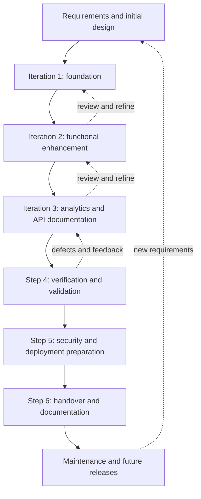

*Figure 1. Reconstructed lifecycle based on project documentation. Feedback arrows illustrate the iterative methodology; they are not a dated activity log or proof that every formal gate passed.*

### 2.2 Development milestones

| Stage | Historical label | Main deliverables | Evidence and status |
|---|---|---|---|
| Analysis and design | Initial planning | Problem, scope, requirements, architecture and data model | SRS remains for approval; current design is documented |
| Iteration 1 | `v0.1` | Authentication, baseline transactions, initial database schema | Historical changelog and current source |
| Iteration 2 | `v0.2` | Category CRUD, case-insensitive category uniqueness, monthly summaries and filters | Historical enhancement plan and current source |
| Iteration 3 | `v0.3` | Expense category chart, income/expense trends and OpenAPI | Historical final build plan and current source |
| Step 4 — verification | `v0.4` | QA automation, browser test definitions, performance protocol, security review and UAT forms | Isolated automated results verified later; formal exit gate unsigned |
| Step 5 — deployment and security | `1.0.0-rc.1` preparation | Persistent sessions, throttling, CI, deployment configuration and recovery tooling | Release candidate previously deployed; operational evidence incomplete |
| Step 6 — handover | RC documentation | SRS, RTM, academic report, API guide and handover artifacts | Documentation modernization ongoing; formal acceptance pending |
| Subsequent maintenance | Unreleased | Bug fixes, lockfiles, MIT license, documentation and QA improvements | Merged GitHub pull requests; no new version declared by this report |

The labels are historical development milestones, not retrospectively assigned Git tags. The changelog records 9 November 2026 as the original release-candidate preparation date, not a verified release publication date. Earlier milestones do not have independently established dates. The existing source snapshot was imported into GitHub on 18 November 2026; the visible Git history is not a complete chronology of all earlier development work.

Historical plans: [Iteration 2](STEP2_ENHANCEMENT_PLAN.md), [Iteration 3](STEP3_FINAL_BUILD_PLAN.md), [changelog](../CHANGELOG.md).

### 2.3 Version control and documentation modernization

The current project uses Git branches, commits, pull requests and CI checks. Subsequent corrective and preventive maintenance is distinguishable from the original three development iterations. The following completed documentation milestones provide the evidence foundation for this report.

| Task | Merged PR | Contribution |
|---|---|---|
| 2.1 — README | [#6](https://github.com/CapTainTeChieF/ExpenseTracker/pull/6) | Project overview, setup, features and six screenshot assets |
| 2.2 — Changelog | [#7](https://github.com/CapTainTeChieF/ExpenseTracker/pull/7) | Version history and maintenance records |
| 2.3 — Architecture and ERD | [#8](https://github.com/CapTainTeChieF/ExpenseTracker/pull/8) | System design, data model, API and authentication lifecycle |
| 2.4 — SRS and traceability | [#9](https://github.com/CapTainTeChieF/ExpenseTracker/pull/9) | Fifteen requirements reconciled with test evidence and gaps |
| 2.5 — Deployment documentation | [#10](https://github.com/CapTainTeChieF/ExpenseTracker/pull/10) | Runbook, release gates and backup/recovery SOP |

This report and its presentation outline constitute Task 2.6 Part A; the master handover update is planned as Task 2.7. The formal academic Word/PDF report and actual slide deck are separate deliverables.

## 3. Requirements analysis

### 3.1 Functional requirements

The requirement IDs and classifications below are reproduced from the current [SRS](STEP6_SRS_v1.0_FOR_APPROVAL.md) and [RTM](STEP6_REQUIREMENT_TRACEABILITY_MATRIX.csv). All nine are classified as implemented at source level. A passing API test is not equivalent to full acceptance of a feature, particularly where browser behavior or documented API compatibility remains to be checked.

| ID | Requirement | Implementation status | Verification status |
|---|---|---|---|
| FR-01 | Register and authenticate account | IMPLEMENTED | PARTIAL |
| FR-02 | Isolate users' financial records | IMPLEMENTED | API_VERIFIED |
| FR-03 | Create income/expense | IMPLEMENTED | PARTIAL |
| FR-04 | View/update/delete transactions | IMPLEMENTED | PARTIAL |
| FR-05 | Categories | IMPLEMENTED | PARTIAL |
| FR-06 | Balance calculation | IMPLEMENTED | PARTIAL |
| FR-07 | Monthly summaries | IMPLEMENTED | API_VERIFIED |
| FR-08 | Chart analytics | IMPLEMENTED | PENDING |
| FR-09 | API compatibility | IMPLEMENTED | PARTIAL |

### 3.2 Non-functional requirements

| ID | Requirement | Implementation status | Verification status |
|---|---|---|---|
| NFR-01 | Dashboard balance refresh within 2 seconds | TARGET_NOT_ESTABLISHED | PARTIAL |
| NFR-02 | ACID transaction safety/rollback | CONTROLS_IMPLEMENTED | PARTIAL |
| NFR-03 | Self-explanatory UI without formal training | TARGET_NOT_ESTABLISHED | PENDING |
| NFR-04 | Privacy and isolation | CONTROLS_IMPLEMENTED | PARTIAL |
| NFR-05 | Availability and recoverability | TOOLING_PROVIDED | PENDING |
| NFR-06 | Integration readiness | DOCUMENTED_CONTRACT | PARTIAL |

The six non-functional requirements are not declared achieved because supporting code or plans exist. The two-second target requires 30 representative browser measurements as defined by the [performance protocol](PERFORMANCE_TEST_PROTOCOL.md). Privacy requires broader production checks. Recoverability requires an approved policy and successful recovery drill. Usability requires first-time user evidence and review. No acceptance threshold or requirement ID is changed in this report.

### 3.3 Use case model

The following model describes implemented end-user goals, not planned features. A guest and an authenticated account holder are two roles of the same individual at different session states. Registration and login can establish a session; protected use cases require a valid, non-revoked session and operate only on the authenticated account's own records. Maintainers and reviewers are external project stakeholders, not in-app administrative users. Developer OpenAPI access and public health checks are documented separately as technical interfaces, not financial user goals.

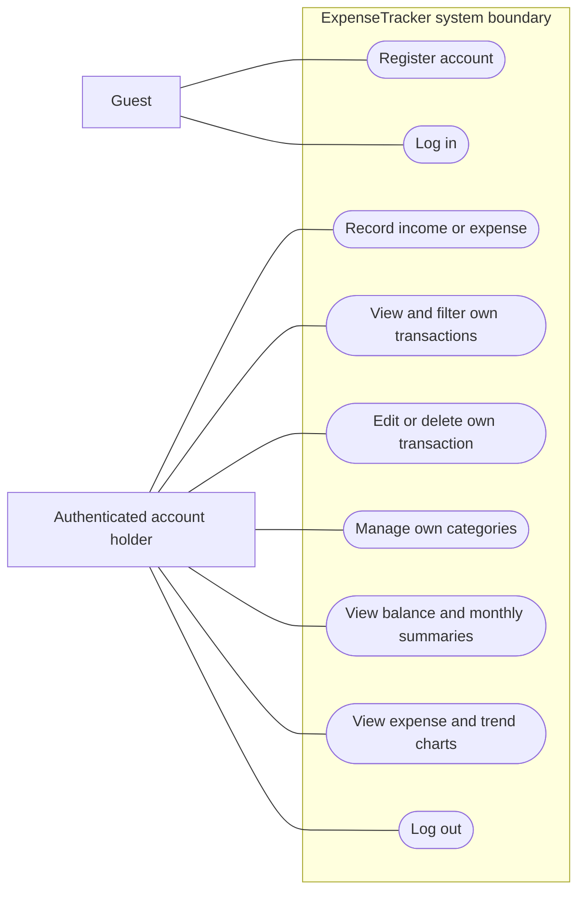

*Figure 2. UML-inspired use case model rendered in Mermaid flowchart notation for GitHub. Rectangles outside the boundary denote actor roles; rounded nodes inside denote goals; plain lines denote participation, not process order. This is not a formal UML serialization.*

| Use case | Preconditions / successful outcome | Relevant SRS IDs |
|---|---|---|
| Register or log in | Valid new account details or existing credentials; server establishes a revocable session | FR-01 |
| Record income or expense | Active session; positive BDT amount, date, kind and optional matching owned category | FR-02, FR-03 |
| View/filter transactions | Active session; only own matching records are returned, up to 100 | FR-02, FR-04 |
| Edit/delete transaction | Active session and ownership; valid update or deletion reflected in summaries | FR-02, FR-04, FR-06, FR-07 |
| Manage categories | Active session; list, create, rename and delete unused owned categories; referenced categories cannot be deleted | FR-02, FR-05 |
| View balance/monthly summary | Active session; totals scoped to user and period | FR-02, FR-06, FR-07 |
| View charts | Active session; category expense distribution and selected trend range | FR-02, FR-07, FR-08 |
| Log out | Active session; revoke server-side session and clear browser cookie | FR-01 |

The use case model is grounded in [frontend source](../frontend/src/App.tsx), [authentication controller](../backend/src/auth/auth.controller.ts), and the [API contract](ARCHITECTURE_AND_ERD.md#3-rest-api-contract-overview). It does not prove that every use case has passed browser or UAT testing.

## 4. System design

### 4.1 Architecture and technology selection

ExpenseTracker uses an API-first modular monolith rather than multiple independently deployed backend microservices. The frontend is a separate React application; NestJS controllers and services provide API and business logic through one backend, with PostgreSQL persistence. This arrangement is a practical fit for the current personal finance scope: it separates presentation from data access while avoiding distributed-service complexity. These explanations are engineering rationale based on the current design, not newly discovered historical decision records.

| Layer | Technology | Role / rationale |
|---|---|---|
| Presentation | React, TypeScript, Vite, Tailwind CSS | Component-based interface, typed application development and responsive styling |
| Analytics | Recharts | Expense category donut and grouped income/expense bar charts |
| Backend | Node.js, NestJS, TypeScript | Modular controllers/services, request validation and REST endpoints |
| Persistence | PostgreSQL, `pg`, SQL migrations | Relational constraints, exact decimal monetary storage and scoped queries |
| Authentication | JWT, HTTP-only cookie, bcrypt, persistent sessions | Account authentication, server-side revocation and password hashing |
| Verification | Jest, Node.js test runner, API scenarios, Playwright | Unit, helper, integration and browser test coverage |
| Development and hosting | Git, GitHub Actions, Docker Compose, Vercel, Render | Version control, CI, isolated local/QA data and documented hosting |

The repository uses Node 24 and PostgreSQL 17 in its documented local/CI configurations. Actual production runtime and database engine versions are not independently confirmed. See [README](../README.md) for setup and configuration; do not repeat provisioning of the deployed services as routine work.

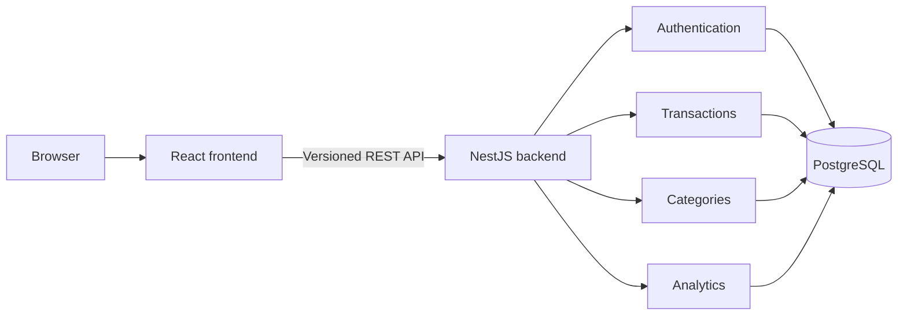

*Figure 3. Simplified logical architecture. Health and database modules support the backend; see the detailed architecture document for the complete design.*

### 4.2 Database design and integrity

The implemented schema comprises five application tables and one operational migration-tracking table. A user may own many transactions, categories and sessions. A transaction optionally references one category belonging to the same user. Rate-limit and migration tables have no user foreign key.

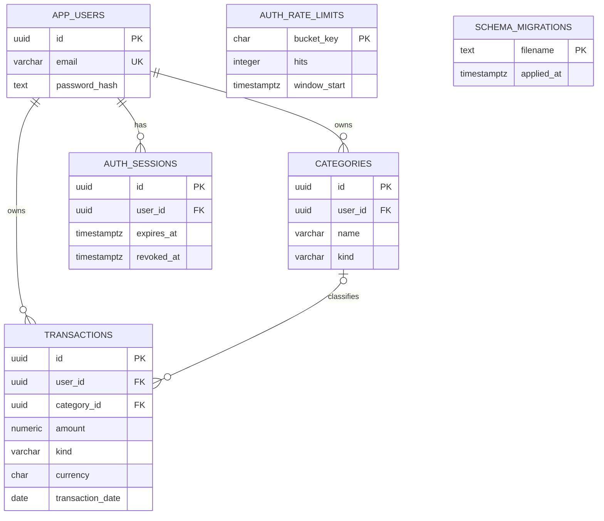

*Figure 4. Simplified relational model showing principal fields and cardinalities. Category reference is nullable; the actual composite ownership constraint, complete attributes, defaults and indexes are documented in [Architecture and ERD](ARCHITECTURE_AND_ERD.md).*

| Table | Responsibility |
|---|---|
| `app_users` | Identity, unique email and password hash |
| `categories` | Owned category names and income/expense classification |
| `transactions` | Owned monetary records, dates, category references and descriptions |
| `auth_sessions` | Session expiration and revocation |
| `auth_rate_limits` | Hashed throttle buckets and hit counts |
| `schema_migrations` | Applied migration filenames and timestamps |

Positive `NUMERIC(14,2)` amounts and BDT currency constraints support consistent monetary storage. A composite category/user foreign key prevents cross-user category references, and the service checks category kind compatibility. Case-insensitive category uniqueness is scoped by user and type. A referenced category cannot be deleted while it remains in use. Indexes on transaction ownership/date and kind support common queries. The three SQL migrations establish the schema, category uniqueness and authentication state respectively. The migration runner records applied filenames; production migration state is not independently verified.

### 4.3 API and authentication design

The backend exposes 16 method/path combinations under `/api/v1`. Public health, register and login routes are distinct from protected account, transaction, category and analytics routes. Controllers accept validated input and delegate to services. Protected operations derive ownership from authenticated identity rather than a user ID supplied in the request body. Development OpenAPI documentation is implemented; production disables the explorer by default unless explicitly enabled.

Authentication uses a signed JWT in the `expense_session` HTTP-only cookie, with a matching active session stored in PostgreSQL. The guard checks signature, user identity, session ID, expiry and revocation. Logout revokes the server session and clears the cookie. The code sets Secure cookies in production, SameSite=Lax, a 12-hour cookie lifetime, production mutation Origin checks and bounded authentication rate limits. These are implemented controls, not evidence of a completed penetration test or live cookie/proxy validation.

The [detailed architecture document](ARCHITECTURE_AND_ERD.md) contains the complete API table and authentication sequence diagram. See the [API integration guide](STEP6_API_INTEGRATION_GUIDE.md) for usage and integration boundaries.

## 5. System implementation and user interfaces

### 5.1 Module responsibilities and financial calculations

| Module | Main responsibility |
|---|---|
| Authentication | Register, login, current account and logout; revocation and throttling |
| Transactions | Create, list, edit and delete own financial records; validate ownership and category |
| Categories | List, create, rename and delete unused categories |
| Analytics | Lifetime totals, monthly totals, category breakdown and rolling monthly trend |
| Health and database | Database connectivity checks, pooled SQL access and migrations |
| Frontend | Authentication forms, dashboard, filters, editing dialog, category manager and charts |

Income and expense are stored as positive amounts with separate transaction kinds. Balance is total income minus total expense. Monthly queries use an inclusive month start and exclusive next-month boundary. SQL aggregates operate over matching user-owned records, not only the displayed transaction list. The list limit of 100 matching records therefore does not itself define the analytics total. The trend endpoint supports one to 12 months, defaults to six and fills missing months with zero totals; the UI exposes 3-, 6- and 12-month ranges. Monetary totals are returned as decimal strings. See [SRS business rules](STEP6_SRS_v1.0_FOR_APPROVAL.md#5-business-rules) and the current architecture notes.

### 5.2 User interface evidence

These six previously committed screenshot assets demonstrate the interface at the captured state. They are illustrative UI evidence, not a current automated browser report or usability test. Use sanitized demonstration data for any new screenshots and verify the live deployment separately.

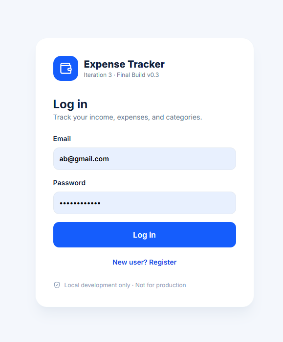

*Figure 5. Login interface with registration option.*

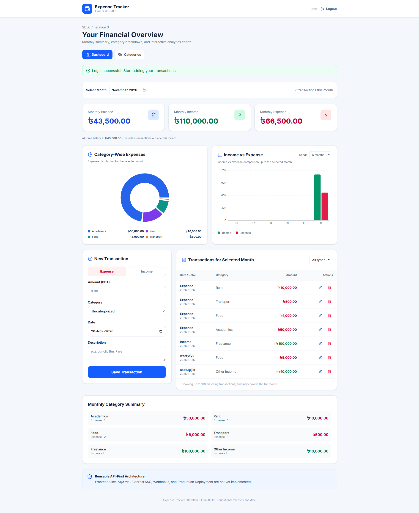

*Figure 6. Financial overview, new transaction workflow and selected-month records.*

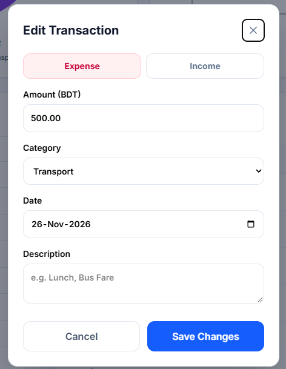

*Figure 7. Transaction editing dialog introduced by the scroll-preservation fix.*

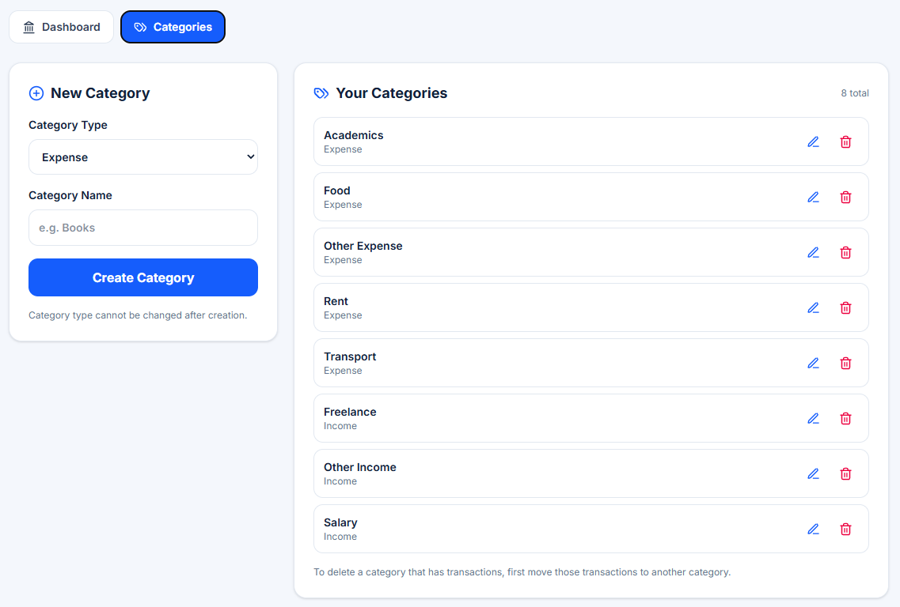

*Figure 8. User-owned income and expense category management.*

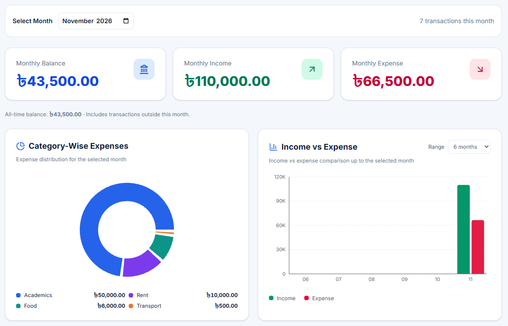

*Figure 9. Expense distribution and income-versus-expense trend visualization.*

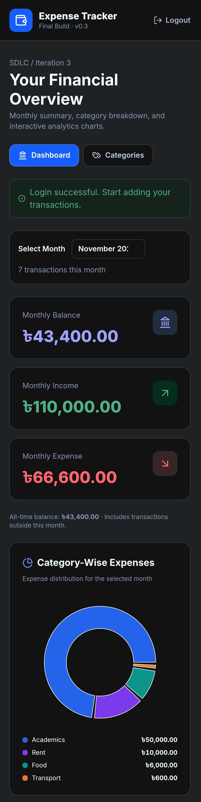

*Figure 10. Mobile interface capture; not proof of compatibility across devices.*

The source still contains historical `v0.3` UI labels and a footer stating production deployment is not yet implemented. These labels are stale relative to the package version and deployment history. They should be corrected in a separately reviewed frontend maintenance change; this documentation task does not modify them.

## 6. Verification, validation and results

### 6.1 Methodology and evidence boundaries

The test approach combines mock-based unit tests, helper tests, API integration against an isolated PostgreSQL database, browser regression definitions, performance measurement, security review and UAT. Recovery validation is a separate operational test. The [QA test matrix](QA_TEST_MATRIX.md) is the canonical mapping from test IDs to actual assertions and requirement coverage. Historical test plans and exit-gate records describe earlier preparation states and use older requirement numbering; the current 15-ID SRS/RTM is authoritative for this revision.

The detailed executed evidence comes from [CI run 45872873003](https://github.com/CapTainTeChieF/ExpenseTracker/actions/runs/45872873003) and its [backend job log](https://github.com/CapTainTeChieF/ExpenseTracker/actions/runs/45872873003/job/140092490848), for commit `2bffa8e` on 26 November 2026 UTC. The workflow used GitHub-hosted Ubuntu, Node 24, PostgreSQL 17 and synthetic QA users/data. The uploaded QA artifact's existence was recorded; its archive contents were not independently inspected. Later [main CI at 443e5d8](https://github.com/CapTainTeChieF/ExpenseTracker/actions/runs/45879244146) passed both jobs. The detailed counts and latency below are from the inspected earlier execution, not attributed to the later run.

### 6.2 Automated test outcomes

| Test group | Executed | Passed | Scope |
|---|---:|---:|---|
| Jest backend tests (five suites) | 10 | 10 | Authentication rollback, categories, transactions and analytics unit behavior |
| Node QA helper tests | 2 | 2 | Percentile calculation and QA database safety guard |
| API integration scenarios | 16 | 16 | `QA-001` through `QA-016` against isolated QA API/database |
| Total | 28 | 28 | Selected automated cases at this baseline |

Backend and frontend type checking and builds passed; they are not additional test cases. Separate linting and Playwright execution are not part of current CI. The total of 28 passed cases is not a code coverage metric or a count of accepted requirements.

| Representative scenarios | Observed outcome |
|---|---|
| QA-002, QA-005, QA-010 | Unauthenticated access rejected, category ownership enforced, foreign transactions excluded and edit/delete rejected |
| QA-003, QA-004 | Registration and independent accounts; duplicate registration and wrong password rejected; profile checked via registration session |
| QA-006, QA-007 | Invalid and foreign-category requests rejected; summary unchanged after invalid write |
| QA-008, QA-009 | Valid synthetic financial records created; monthly income 1,000 BDT, expense 250 BDT, balance 750 BDT; grouping and trend checked |
| QA-011, QA-012 | Referenced category deletion rejected; invalid update preserves prior total; valid update reflected in balance |
| QA-013, QA-014, QA-016 | Wrong Origin rejected in QA, revoked cookie rejected and repeated bad login throttled |
| QA-015 | Ten local create-and-summary timing samples recorded |

Successful credential login, exact cookie attributes, positive unused-category deletion, all-time income/balance across multiple months, and browser chart rendering still require additional direct evidence. The integration scenarios do not establish full fault-injection recovery or comprehensive production security.

### 6.3 Performance results and interpretation

| Measurement | Observed result |
|---|---:|
| QA-015 samples | 10 |
| Median (P50) | 5 ms |
| P95 | 14 ms |
| Maximum | 14 ms |

The measured interval covers small local API create-and-refreshed-summary requests. It does not include browser rendering, remote network latency, mobile conditions, production load or hosting cold starts. Consequently, the two-second dashboard requirement (NFR-01) is **partially verified**, not accepted. A representative 30-trial commit-to-visible-balance browser measurement, with mobile repetition and all misses recorded, remains required under the documented protocol. No invented measurements or latency distribution are supplied.

### 6.4 Requirement verification and outstanding validation

| RTM classification | Count | IDs |
|---|---:|---|
| API_VERIFIED | 2 | FR-02, FR-07 |
| PARTIAL | 10 | FR-01, FR-03, FR-04, FR-05, FR-06, FR-09, NFR-01, NFR-02, NFR-04, NFR-06 |
| PENDING | 3 | FR-08, NFR-03, NFR-05 |
| Total | 15 | Nine functional and six non-functional |

All nine functional requirements are implemented in source; the classifications summarize available verification evidence, not percentages of project completion. API_VERIFIED is restricted to tested behavior. PARTIAL means evidence exists but gaps remain. PENDING means sufficient executed evidence has not been established at the baseline.

| Remaining activity | Required evidence |
|---|---|
| Browser regression | Three Playwright test definitions across two configured Chromium projects (six configured executions); current report not established |
| Representative performance | PERF-30 raw timings, environment, workload, percentile summary and misses |
| Reliability | Fault/interruption and recovery evidence (REL-02) |
| Privacy/security | Live cookie, Origin, proxy/IP, transport and remaining risk review |
| UAT | First-time user tasks, observed issues and reviewer sign-off |
| Recoverability | Approved RPO/RTO, observed staging recovery, reconciliation and reviewer decision |
| API compatibility | Development OpenAPI output, production-default disablement and contract review |

Earlier project handover context reports 20 successful manual production smoke checks in a previous session. The individual records, exact deployed revision and timing have not been independently inspected for this report. This is attributed historical evidence only; it is not counted with the 28 automated tests or represented as current production acceptance. Formal SRS, Step 4 gate and UAT sign-offs remain unsigned. See [QA matrix](QA_TEST_MATRIX.md), [RTM](STEP6_REQUIREMENT_TRACEABILITY_MATRIX.csv) and [UAT sign-off template](STEP6_UAT_SIGNOFF_TEMPLATE.md).

## 7. Deployment, security and operations

### 7.1 Documented deployment topology

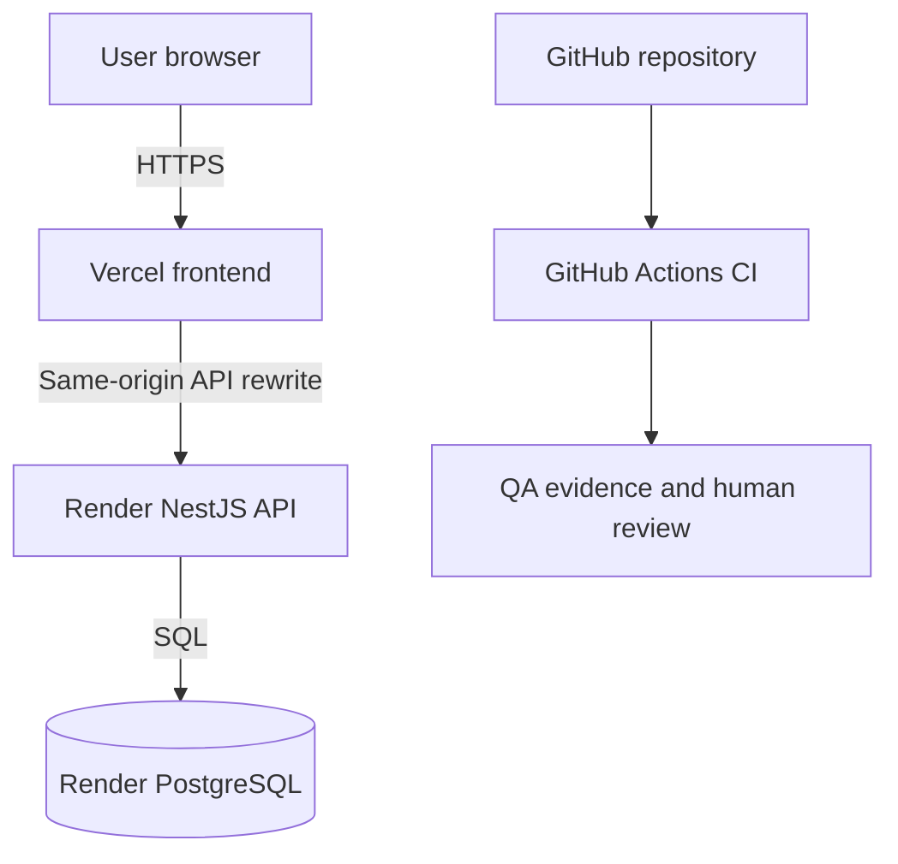

*Figure 11. Documented deployment architecture and separate continuous integration path. No automatic production deployment is asserted.*

| Component | Documented location |
|---|---|
| Frontend | [Vercel application](https://expensetracker-eight-sable.vercel.app) |
| API | [Render health endpoint](https://expense-tracker-api-bbp8.onrender.com/api/v1/health) |
| Database | Render-hosted PostgreSQL |
| Source and CI | [GitHub repository](https://github.com/CapTainTeChieF/ExpenseTracker) and [Actions](https://github.com/CapTainTeChieF/ExpenseTracker/actions) |

The committed Vercel rewrite forwards `/api/v1/:path*` to the Render origin before the SPA fallback. This supports same-origin browser requests and the session cookie model. The release candidate was deployed according to project history. Live provider settings, actual deployed SHA, current health, database plan/expiry and provider auto-deploy behavior were not verified by this revision. The health endpoint checks database connectivity, not financial integrity or availability over time.

### 7.2 Continuous integration and release governance

GitHub Actions CI executes backend and frontend checks on configured pushes and pull requests. The separate manual approval workflow does not deploy the application. Both dependency lockfiles are committed, but CI and the Dockerfile still use `npm install`; migration to immutable dependency installation and a dependency/security review remain maintenance work.

The [release gates](STEP5_RELEASE_GATES.md) record 12 gates: two passed in isolated QA scope, three partial, six pending and one blocked. Stable-release approval remains blocked. Passing CI and prior deployment do not justify claiming production readiness or publishing a stable `v1.0.0` release.

### 7.3 Security and data integrity

| Implemented control | Evidence boundary |
|---|---|
| Signed session cookie and database revocation | Copied revoked cookie rejected in isolated QA; production cookie attributes pending |
| User-scoped SQL and category ownership constraint | Selected cross-user denials verified; broader authorization review outstanding |
| Input validation and financial constraints | Invalid writes rejected; interruption/recovery tests pending |
| Authentication throttling | Account-throttle scenario passed; real proxy/IP behavior pending |
| Origin enforcement and security headers | Wrong Origin rejected in QA; live transport, headers and proxy behavior pending |
| Password hashing and secret configuration checks | Present in code; no full independent security certification |

The application protects sensitive financial records through layered source controls, but operational security depends on correct runtime configuration and further review. Never include passwords, database URLs, session cookies, JWT secrets or real financial records in public report evidence. See [security changes and remaining risks](STEP5_SECURITY_CHANGES_AND_REMAINING_RISKS.md).

### 7.4 Backup, recovery and monitoring

Existing PowerShell scripts provide PostgreSQL custom-format logical dumps and guarded staging restores. Archive listing is not a full restore test. The restore script is destructive to its target and not atomic; the existing scripts also require review of credential exposure through process arguments. Real backup and restore operations must be separately authorized and isolated from valuable data.

The [backup SOP](STEP5_BACKUP_RECOVERY.md) proposes daily backups, 24-hour RPO, four-hour RTO, 30-day retention, encrypted independent storage and monthly recovery drills. These targets are proposals, not approved or measured service commitments. Permanent database hosting, automated backups, successful recovery evidence, monitoring and alerting are outstanding. The [deployment runbook](STEP5_DEPLOYMENT_RUNBOOK.md) documents intended configuration, diagnostics and rollback procedures, not proof of execution.

## 8. Maintenance, limitations and future work

### 8.1 Maintenance history and defect tracking

| Finding | Recorded response | Current status |
|---|---|---|
| BUG-001 — authentication startup/logout screen | Default login behavior fixed ([PR #3](https://github.com/CapTainTeChieF/ExpenseTracker/pull/3)) | Fix merged; current browser regression evidence pending |
| BUG-002 — transaction edit scroll behavior | Modal editing, separated draft state and regression definition ([PR #4](https://github.com/CapTainTeChieF/ExpenseTracker/pull/4)) | Fix merged; current browser regression evidence pending |
| BUG-003 — Windows local QA runner | Previously reported execution problem | Resolution not established |
| BUG-004 — incomplete release approvals can succeed | Documented shell conditional-chain defect ([issue #11](https://github.com/CapTainTeChieF/ExpenseTracker/issues/11)) | Open at audit; fix and regression verification pending |

The release workflow defect affects governance, not automatic application deployment. The release gates document records six invalid combinations that succeeded in a local Bash simulation of 16 synthetic input combinations. The proposed regression criterion is exactly one success: all three approvals true with a nonempty ticket. Genuine approval evidence remains necessary even after a fix. No workflow dispatch or fix is performed here.

The project illustrates corrective maintenance (defect fixes), adaptive maintenance (hosting and API proxy configuration), preventive maintenance (security controls and dependency maintenance), and perfective maintenance (interface improvements and clearer documentation). These categories are explanatory classifications of documented changes, not additional completed development tasks.

### 8.2 Limitations and recommended next steps

| Area | Limitation | Proposed follow-up |
|---|---|---|
| Operational resilience | Long-term database plan and tested recovery not established | Confirm durable hosting, backup policy and staging recovery |
| Release governance | BUG-004 and unsigned acceptance gates | Fix workflow separately; verify all regression cases and genuine approvals |
| Quality assurance | Browser, representative performance, fault recovery and UAT incomplete | Execute and preserve scoped, sanitized evidence |
| Security | Production behavior, advisory review and monitoring incomplete | Review live controls and add appropriate operational monitoring |
| Reproducibility | CI/Docker use npm install despite committed lockfiles | Review npm ci migration and dependency update process |
| User interface | Stale version/deployment labels and incomplete accessibility evidence | Correct labels in a dedicated maintenance PR; assess responsive/accessibility behavior |
| Data and integration | BDT-only, 100-record list limit, no shared workspaces or external SSO/client permissions | Consider pagination, export, multi-currency or integrations only after maintenance priorities |

These are proposed priorities, not committed feature promises or approved release schedules.

## 9. Conclusion and academic submission readiness

ExpenseTracker demonstrates how an iterative development model can evolve a basic transaction system into a modular personal finance application with analytics, relational integrity and a documented cloud deployment. The source implements the nine functional requirements, and the inspected QA baseline supplies genuine evidence of 28 passed automated cases. Requirements traceability, software maintenance history and operational documentation make the project suitable for an evidence-based academic discussion.

The current result is a deployed release-candidate project with incomplete formal acceptance, not a certified stable production system. The two-second browser target, UAT, comprehensive production security, backup recovery, BUG-004 resolution and other release prerequisites remain open. The report preserves these gaps instead of fabricating approval or claiming all requirements passed.

Before formal academic submission: cross-check the original proposal, obtain instructor requirements and submission details, review diagrams and references, capture any additionally required evidence, complete the master handover and prepare the formatted report and presentation. The academic reviewer determines whether the release-candidate scope and evidence satisfy the course requirements. Academic assessment and stable-release approval remain separate decisions.

## 10. References and evidence index

### Project sources (repository baseline `443e5d8`)

| Reference | Purpose |
|---|---|
| [README](../README.md), [MIT license](../LICENSE) and [changelog](../CHANGELOG.md) | Project overview, development and maintenance history |
| [Iteration 2 enhancement plan](STEP2_ENHANCEMENT_PLAN.md), [Iteration 3 final build plan](STEP3_FINAL_BUILD_PLAN.md) | Historical development methodology and scope |
| [SRS for approval](STEP6_SRS_v1.0_FOR_APPROVAL.md), [RTM](STEP6_REQUIREMENT_TRACEABILITY_MATRIX.csv) | Requirement IDs, acceptance criteria and evidence classifications |
| [Architecture and ERD](ARCHITECTURE_AND_ERD.md), [API integration guide](STEP6_API_INTEGRATION_GUIDE.md) | Technical design and interface contract |
| [QA matrix](QA_TEST_MATRIX.md), [performance protocol](PERFORMANCE_TEST_PROTOCOL.md), [UAT checklist](UAT_CHECKLIST.md) | Executed test scope and pending verification |
| [Deployment runbook](STEP5_DEPLOYMENT_RUNBOOK.md), [release gates](STEP5_RELEASE_GATES.md), [backup SOP](STEP5_BACKUP_RECOVERY.md) | Operational procedures, governance and remaining risks |
| [Security changes and risks](STEP5_SECURITY_CHANGES_AND_REMAINING_RISKS.md), [security review](SECURITY_REVIEW.md) | Historical and implemented security controls |
| [Presentation outline](STEP6_PRESENTATION_OUTLINE.md), [handover checklist](STEP6_HANDOVER_CHECKLIST.md) | Academic demonstration and handover; checklist awaits modernization |
| [Detailed CI run](https://github.com/CapTainTeChieF/ExpenseTracker/actions/runs/45872873003), [latest audited main CI](https://github.com/CapTainTeChieF/ExpenseTracker/actions/runs/45879244146) | Executed automated evidence and later CI status |
| [Issue #11](https://github.com/CapTainTeChieF/ExpenseTracker/issues/11), [merged PR history](https://github.com/CapTainTeChieF/ExpenseTracker/pulls?q=is%3Apr+is%3Amerged) | Maintenance traceability |

### Technical documentation references

Official documentation entry points for further study and citation checking when preparing the formatted submission:

- [React documentation](https://react.dev/), [TypeScript handbook](https://www.typescriptlang.org/docs/), [Vite guide](https://vite.dev/guide/), [Recharts documentation](https://recharts.org/).
- [NestJS documentation](https://docs.nestjs.com/), [PostgreSQL 17 documentation](https://www.postgresql.org/docs/17/).
- [Jest documentation](https://jestjs.io/docs/getting-started), [Playwright documentation](https://playwright.dev/docs/intro), [GitHub Actions documentation](https://docs.github.com/en/actions).
- [Vercel documentation](https://vercel.com/docs), [Render documentation](https://render.com/docs).

Original academic proposal: *Personal Expense Tracker with Analytics*, two-page PDF, as referenced in the historical report. Direct inspection and full bibliographic information remain pending. No proposal approval, instructor name, student identifiers or academic sign-off are invented in this repository draft.
